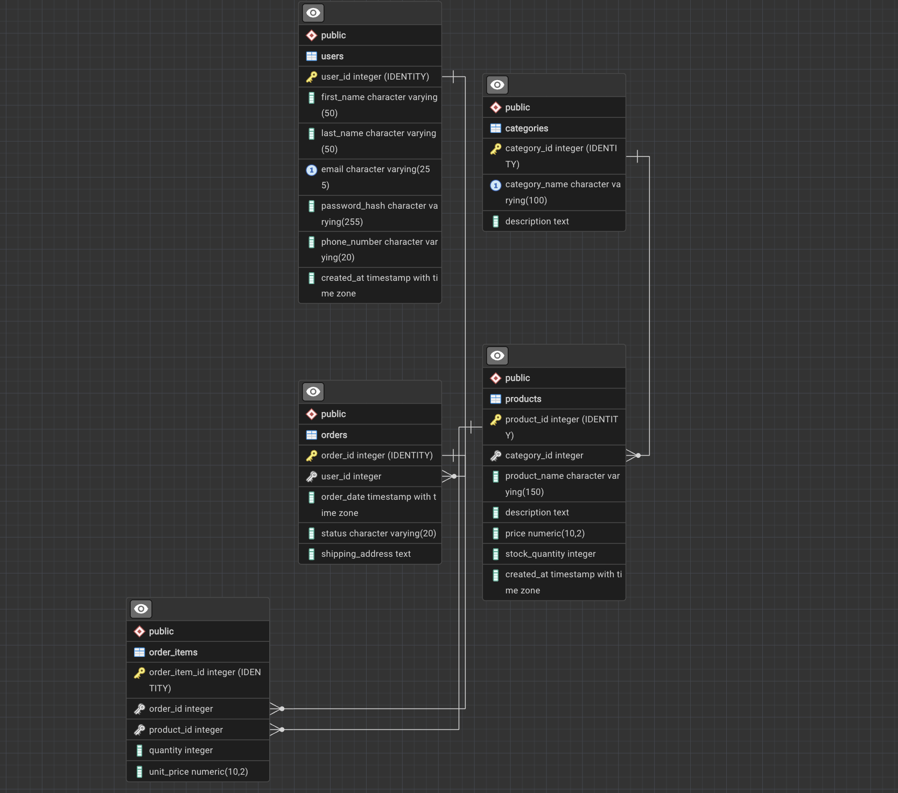

# RevoShop Database

PostgreSQL schema, seed data and sample queries for the RevoShop store.
Tables: `users`, `categories`, `products`, `orders`, `order_items`.
All prices are in Indonesian Rupiah (IDR).

## Prerequisites
- PostgreSQL 16+ (developed on 18)
- pgAdmin 4 (optional, for the GUI)

> **Note: `psql` may not be on your PATH.** If you see `psql: command not found`,
> call it with its full path or add its folder to your PATH:
> - macOS (EDB installer): `/Library/PostgreSQL/18/bin/psql`
> - macOS (Homebrew): `/opt/homebrew/opt/postgresql@16/bin/psql`
> - Windows: `C:\Program Files\PostgreSQL\18\bin\psql.exe`
> - Linux (apt): normally already on PATH
>
> The commands below use plain `psql`; replace it with the full path if needed.

## Setup
1. Create the database (pgAdmin: right-click **Databases > Create > Database...**
   and name it `revoshop_db`, or use the command below):
   ```bash
   psql -h localhost -U postgres -c "CREATE DATABASE revoshop_db;"
   ```
2. Create the tables:
   ```bash
   psql -h localhost -U postgres -d revoshop_db -f schema.sql
   ```
3. Load the sample data:
   ```bash
   psql -h localhost -U postgres -d revoshop_db -f seed.sql
   ```
4. Run the example queries:
   ```bash
   psql -h localhost -U postgres -d revoshop_db -f queries.sql
   ```

`schema.sql` drops and recreates all tables, so re-running it (then `seed.sql`)
resets the database.

## Schema


| Table | Primary key | Foreign keys |
|---|---|---|
| users | user_id | - |
| categories | category_id | - |
| products | product_id | category_id -> categories |
| orders | order_id | user_id -> users |
| order_items | order_item_id | order_id -> orders, product_id -> products |

`order_items` is the junction table between orders and products (many-to-many).

## Design notes
- `order_items.unit_price` stores the price at the time of purchase, so later
  changes to `products.price` do not rewrite order history.
- `ON DELETE CASCADE` is only on `order_items.order_id`: a line item cannot exist
  without its order. `product_id` and `orders.user_id` have no cascade, so
  products or users with order history cannot be deleted by accident.
