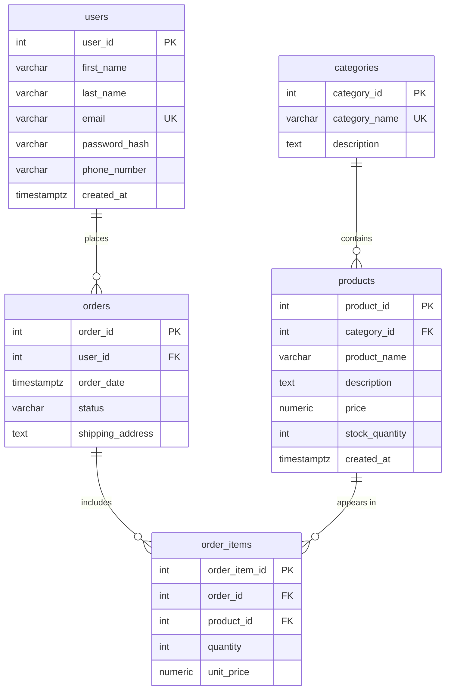

# RevoShop Database

PostgreSQL schema, seed data and sample queries for the RevoShop store.
Tables: `users`, `categories`, `products`, `orders`, `order_items`.

## Prerequisites
- PostgreSQL 16+ (developed on 18) with `psql` available
- pgAdmin 4 (optional, for the GUI)

## Setup
1. Create the database (pgAdmin: right-click **Databases > Create > Database...**
   and name it `revoshop_db`, or use the command below):
   ```bash
   psql -h localhost -U postgres -c "CREATE DATABASE revoshop_db;"
   ```
2. Create the tables:
   ```bash
   psql -h localhost -U postgres -d revoshop_db -f schema.sql
   ```
3. Load the sample data:
   ```bash
   psql -h localhost -U postgres -d revoshop_db -f seed.sql
   ```
4. Run the example queries:
   ```bash
   psql -h localhost -U postgres -d revoshop_db -f queries.sql
   ```

`schema.sql` drops and recreates all tables, so re-running it resets the database.

## ERD Reva


## Schema


| Table | Primary key | Foreign keys |
|---|---|---|
| users | user_id | - |
| categories | category_id | - |
| products | product_id | category_id -> categories |
| orders | order_id | user_id -> users |
| order_items | order_item_id | order_id -> orders, product_id -> products |

`order_items` is the junction table between orders and products (many-to-many).
## Entity Relationship Diagram


